# HomeLedger

**Your entire home, organized.** A native, privacy-first iPhone app for everything you own and everything it needs: inventory with photos, receipts and manuals, warranty reminders, maintenance schedules, repair history, home expenses and an insurance-ready PDF inventory — all stored on your device, no account required.

<p align="center">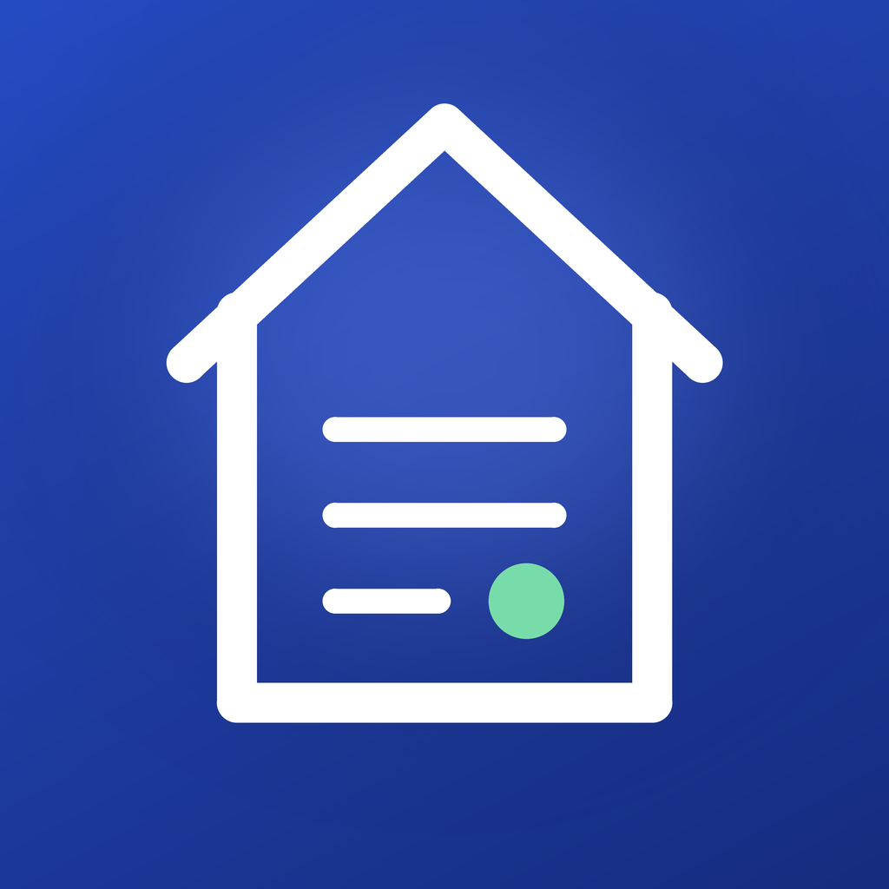</p>

## Screenshots

Captured automatically by CI on the iOS 26.2 simulator (iPhone 17 Pro) using the built-in sample household.

| Dashboard | My Home | Item detail | Maintenance |
|---|---|---|---|
| 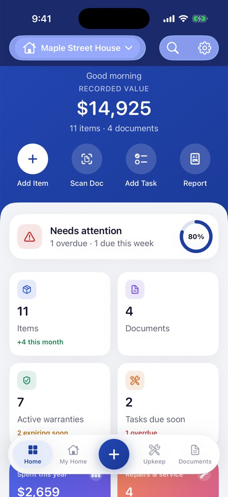 | 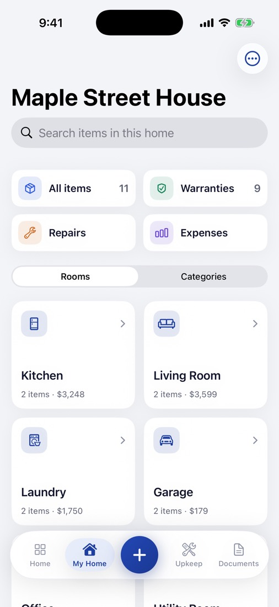 | 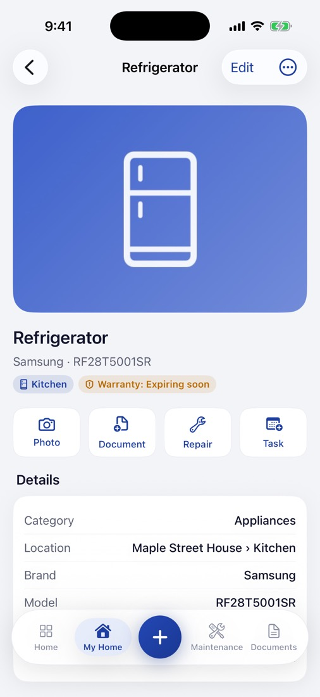 | 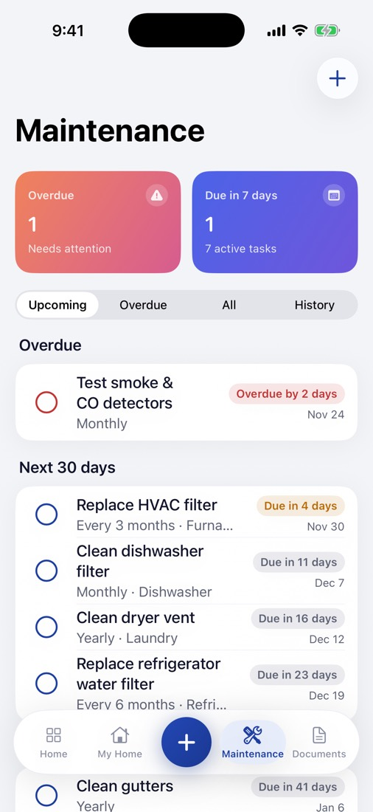 |
| **Documents** | **Warranties** | **Expenses** | **Ask (local assistant)** |
| 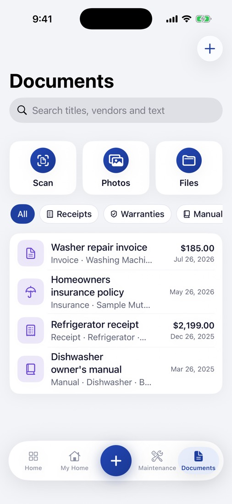 | 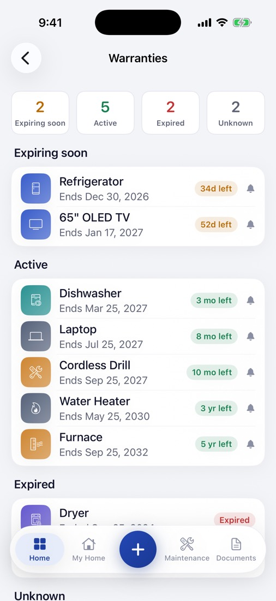 | 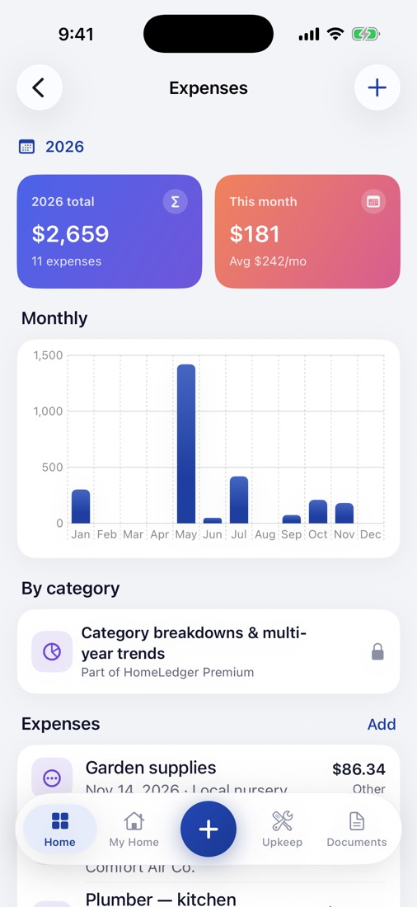 | 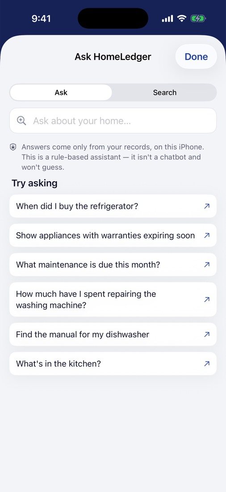 |
| **Onboarding** | **Inventory report** | **Dark mode** | **Largest text size** |
| 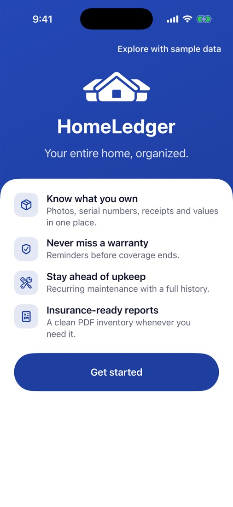 | 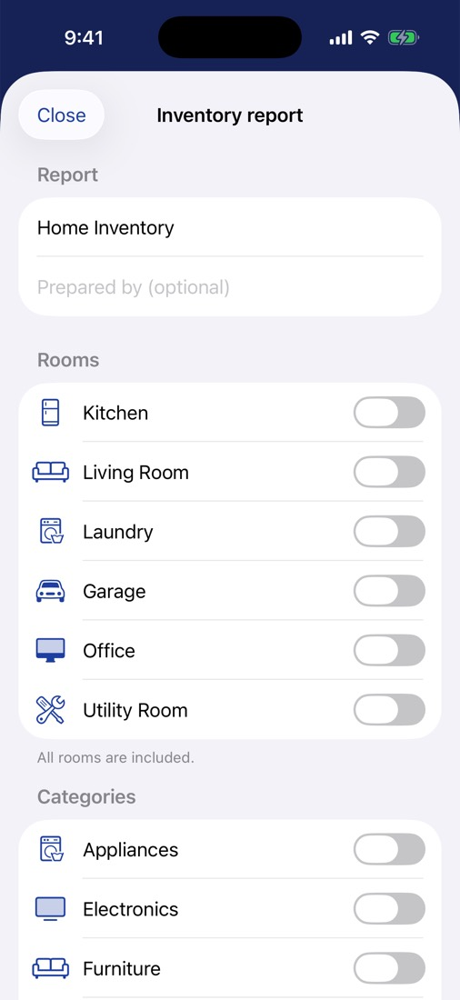 | 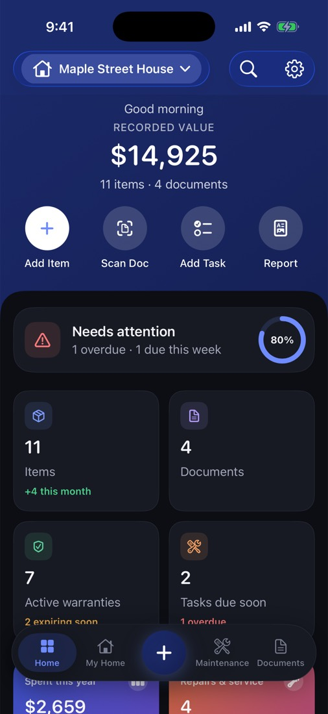 | 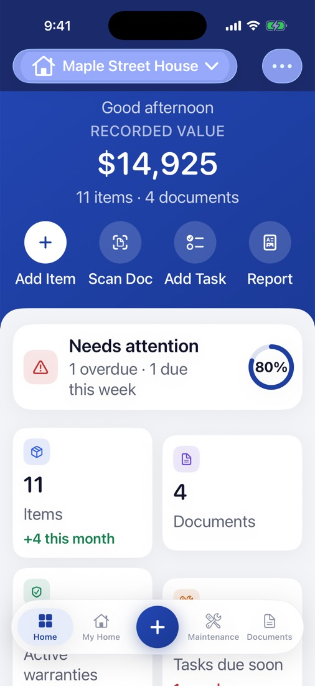 |

## Features

| Area | What you get |
|---|---|
| **Onboarding** | Skippable intro, create a home (name + type), optional room suggestions, plain-language privacy explanation, notification permission asked only after explaining why, one-tap **sample data** mode that can be removed cleanly. |
| **Dashboard** | Recorded value, item/document counts, maintenance "on track" ring, tappable metric tiles (items, documents, warranties, tasks), spend & repair highlights, upcoming tasks with one-tap completion, warranties ending soon, recently added, recent activity, quick actions (Add Item, Scan Doc, Add Task, Report). |
| **Homes & rooms** | Multiple homes (Premium), rooms with icons, reorder/rename/delete with clear consequences, custom categories, Unassigned bucket. |
| **Inventory** | Name, category, room, brand, model, serial, barcode/QR (VisionKit scanner), purchase date/price/retailer, warranty start/end/provider/notes, condition, quantity, notes, multiple photos, replacement value, timestamps. Duplicate, move, archive, delete; search/sort/filter/group; full timeline; optional "make this record more complete" hints. |
| **Documents** | Import from Files, Photos or the document camera (multi-page → PDF). On-device OCR extracts vendor, date, item, model, serial, amount, warranty period/end — **always shown for review**, each field labelled *Detected* or *Best guess*, originals preserved. |
| **Warranties** | Expiring soon / active / expired / unknown; per-item reminders (30/14/7 days by default; custom intervals in Premium); estimated dates clearly labelled; no duplicate notifications. |
| **Maintenance** | One-time and recurring tasks (days/weeks/months/years, fixed schedule or from completion), 12 editable suggestions, priority, cost, linked item/room, reminders, complete/snooze/skip/reschedule, full history. |
| **Repairs & service** | Issue, type, date, vendor, cost, follow-up reminder, linked item/task; cost automatically mirrored to Expenses. |
| **Expenses** | Monthly chart, year totals, this month, average/month; category breakdown & year-over-year (Premium); lifetime cost per item. |
| **Inventory report** | PDF filtered by home/rooms/categories; choose photos, serials, purchase details, replacement values, notes; share or save to Files. Clearly states it's a personal record, not an appraisal. |
| **Search & Ask** | Global search across every record type including recognized document text; a local rule-based assistant that answers only from your records and shows the supporting records. |
| **Data control** | Versioned backup export/restore (merge or replace, validated first, safety backup before replace), delete all data, privacy page, help. |
| **Premium** | StoreKit 2 yearly subscription (with free trial) and lifetime purchase, restore purchases, entitlements derived only from verified transactions. |

## Requirements

- iOS **17.0+**, iPhone
- Xcode **16+** (CI uses Xcode 26.3 with the iOS 26.2 SDK)
- [XcodeGen](https://github.com/yonaskolb/XcodeGen) to generate the Xcode project (`brew install xcodegen`)

**Why iOS 17:** SwiftData and the Observation framework are iOS 17+. They provide a versioned schema, migration plan and reactive queries with much less code and risk than Core Data, and iOS 17+ covers the large majority of active iPhones.

## Build & run

```bash
git clone https://github.com/surproductions/HomeLedger.git
cd HomeLedger
brew install xcodegen
xcodegen generate
open HomeLedger.xcodeproj
```

Select the **HomeLedger** scheme and an iPhone simulator, then Run. The scheme uses `Config/HomeLedger.storekit`, so purchases work locally without App Store Connect.

To run on a physical iPhone, set your Team under *Signing & Capabilities* (Automatic signing).

## Tests

```bash
xcodebuild test -project HomeLedger.xcodeproj -scheme HomeLedger \
  -destination 'platform=iOS Simulator,name=iPhone 17 Pro' \
  -only-testing:HomeLedgerTests          # unit tests
xcodebuild test -project HomeLedger.xcodeproj -scheme HomeLedger \
  -destination 'platform=iOS Simulator,name=iPhone 17 Pro' \
  -only-testing:HomeLedgerUITests        # UI tests
```

Unit tests cover the model and deletion rules, persistence across relaunch, recurrence math, warranty status and reminder scheduling (with a mock notification center), the receipt parser plus the real Vision/PDFKit OCR pipeline, expense and money calculations, PDF report content, backup round-trip, merge and validation, search and the assistant, and StoreKit purchases via `SKTestSession`.

UI tests cover the seven critical flows: first launch and home creation; adding an item with photos; attaching a receipt and reviewing extracted fields; adding a warranty with reminders; creating and completing a recurring task; generating and sharing a PDF; and exporting and restoring a backup.

UI tests launch with `-UITesting -ResetData` (and optionally `-SeedSampleData`). In **Debug builds only**, UI-testing mode adds a "test photo" and "test receipt" source because the simulator has no camera. Nothing unlocks purchases.

## Continuous integration & IPA

`.github/workflows/ios.yml` runs on every push and does the following:

1. Generates the project, builds for testing, then runs unit and UI tests on the newest iPhone simulator.
2. Captures screenshots of the main screens (light, dark and large text).
3. Archives a **Release build without code signing** and packages `HomeLedger-1.0.0-unsigned.ipa` plus the `.xcarchive`.
4. Uploads everything as workflow artifacts. Run the workflow manually with **release = true**, or include `[release]` in a commit message, to publish a GitHub pre-release with these files.

### Installing on an iPhone (signing)

An IPA must be signed with an Apple certificate and provisioning profile before iOS will install it. CI has no Apple credentials, so the IPA it produces is **unsigned**. To get an installable build, use one of these options:

- **Xcode (recommended):** open the project, set your Team, connect your iPhone, then Run. Or use *Product › Archive › Distribute App* (Development, Ad Hoc or App Store Connect/TestFlight).
- **Re-sign the unsigned IPA** with your own Apple ID using a sideloading tool (for example AltStore or Sideloadly), or with `codesign` and a provisioning profile.
- **Signed CI builds:** add `BUILD_CERTIFICATE_BASE64`, `P12_PASSWORD`, `PROVISIONING_PROFILE_BASE64` and `TEAM_ID` repository secrets, then replace `CODE_SIGNING_ALLOWED=NO` with an `-exportArchive` step using an `ExportOptions.plist`.

## Architecture

SwiftUI and SwiftData, with an `@Observable` app model and pure domain services. See [docs/ARCHITECTURE.md](docs/ARCHITECTURE.md). Key points:

- **Local-first:** records live in SwiftData. Photos and documents are files under Application Support, protected with iOS Data Protection.
- **Schema versioning:** a `VersionedSchema` plus a `SchemaMigrationPlan`. Every model has a stable UUID, attribute defaults and optional relationships, so it's ready for CloudKit.
- **Pure, tested logic:** recurrence, reminder planning, receipt parsing, expense math, entitlement resolution, search and assistant.
- **Product IDs:** defined in a single file, `HomeLedger/Store/StoreConfiguration.swift`.

More docs: [Product spec & research](docs/PRODUCT_SPEC.md) · [Design system](docs/DESIGN_SYSTEM.md) · [Privacy policy draft](docs/PRIVACY.md)

## Privacy & data handling

- No account, analytics, ads or third-party SDKs. The only network calls are StoreKit (App Store).
- OCR runs on device with Apple Vision; documents are never uploaded.
- Exports and backups leave the device only when you share them. Backups are **not encrypted**, and the app says so.
- Settings › Delete all data removes everything, after a typed confirmation.

## Known limitations

- **No iCloud sync or household sharing yet.** The data model is ready for it, but sync couldn't be validated on real iCloud accounts here, so it isn't shipped (and the UI doesn't pretend otherwise).
- **OCR extraction is rule-based.** It works best on typed receipts and invoices; handwriting and unusual layouts often need manual entry. The assistant is pattern-based too, not a language model.
- **Backups are unencrypted JSON** with embedded files. Very large libraries create large files.
- The barcode scanner and document camera need a real device (iPhone XS or later for barcodes).
- iPhone only, portrait only. No iPad layout yet.
- The CI IPA is unsigned (see *Installing on an iPhone*).
- Product IDs and prices must be created in App Store Connect before release.

## License

Copyright © 2026 surproductions. All rights reserved.
